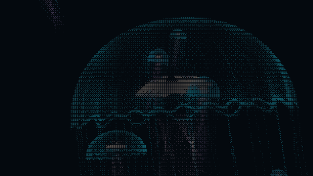

# Kurage Aquarium

[](LICENSE)
[](https://github.com/Hosi121/kurage-aquarium/tags)

Procedural jellyfish drawn with colored Braille dots. Preview a jellyfish in your
terminal, or use a looping aquarium GIF as a Windows Terminal or WezTerm background.



The aquarium uses eight independent swimmers with staggered entrances and exits.
Each bell points along its path, contracts to advance, and leaves its filaments
following earlier positions and orientations. The motion is a visual
approximation, not a fluid simulation.

## Use a pre-rendered background

Playback does not need Python or FFmpeg. Download the full-size GIF or
`kurage-wezterm.tar.gz` from the
[v0.2.0 release](https://github.com/Hosi121/kurage-aquarium/releases/tag/v0.2.0).

- **macOS / Ubuntu / Linux:** follow the [WezTerm setup guide](docs/wezterm.md).
  The bundle includes the GIF, a reusable background module, and a configuration
  for trying it in a separate window. The image is centered and has 70% opacity.
- **Windows Terminal:** download `aquarium.gif` and use the
  [profile settings below](#windows-terminal).

| Terminal | Background setup | Validation |
| --- | --- | --- |
| Windows Terminal | Animated GIF; [settings example](examples/windows-terminal.json) | Used on Windows through WSL |
| WezTerm on macOS / Linux | Animated GIF; [Lua module](examples/kurage-background.lua) | Configuration checked with Linux WezTerm; macOS GUI playback unverified |
| GNOME Terminal / macOS Terminal | WezTerm configuration does not apply | No animated-background integration provided |

WezTerm animates background GIFs while the window has focus, as described in its
[background documentation](https://wezterm.org/config/lua/config/background.html).
This integration does not modify your default terminal or existing settings.

## Generate an animation or develop

Python 3.10 or later is required. GIF export also requires FFmpeg and a font
containing Braille glyphs. Development and export have been tested on Ubuntu/WSL
with Python 3.12.

On Ubuntu/WSL, install the system dependencies:

```sh
sudo apt install python3-venv ffmpeg fonts-dejavu-core
```

Clone and install:

```sh
git clone https://github.com/Hosi121/kurage-aquarium.git
cd kurage-aquarium
python3 -m venv .venv
source .venv/bin/activate
python -m pip install -e .
```

## Terminal preview

```sh
kurage
kurage --ascii
kurage --static --width 52 --height 42
```

The live viewer uses 30 fps by default; press Ctrl+C to stop. Braille mode draws
2 × 4 dots per character cell. `--ascii` selects ordinary ASCII characters.
Redirected output is a still frame. `NO_COLOR` or `--no-color` disables ANSI colors.

## Export a background

```sh
kurage-export output/aquarium.gif
```

The default aquarium is 1280 × 720, 30 fps, and 38.4 seconds long. Rendering takes
time; it prints progress while FFmpeg writes the GIF. A PNG of the first frame is
saved alongside the GIF. Once exported, playback needs no Python process.

Export uses up to four CPU processes by default. To choose the process count:

```sh
kurage-export output/aquarium.gif --workers 4
kurage-export output/aquarium.gif --workers 1
```

Independent light buffers are rendered in parallel. The temporal filter still
runs in frame order, preserving the motion and colors. Only a bounded number of
frames are in flight; the whole animation is not kept in memory. Glyph masks are
cached and composited in batches. Fonts whose glyphs overlap adjacent cells use
the original ordered drawing path. Worker light buffers pass through a bounded
shared-memory ring rather than being serialized through process pipes.

One complete default export on a WSL machine with 16 available logical CPUs
(Python 3.12, NumPy 2.5.4, Pillow 13.0.0) measured:

| Implementation | Rendering processes | Wall time |
| --- | ---: | ---: |
| Original exporter (`v0.1.0`) | 1 | 77.79 s |
| First parallel exporter (`65e3d10`) | 4 | 20.69 s |
| Cached geometry, sparse shading, batched glyphs, shared buffers | 4 | 14.15 s |

These are single runs including startup, palette creation, rendering, and GIF
encoding, using the same 1280 × 720, 30 fps, 38.4-second scene and font. The two
parallel versions were measured consecutively; the serial result is from the
earlier optimization pass on the same machine. Both the GIF and first-frame
PNG had identical SHA-256 hashes across all versions. An eight-process trial
took 13.66 s, so the default stays at four to avoid doubling the process count
for a small gain. Timings depend on the machine; `--workers 1` also works when
process shared memory is unavailable.

### Lossless GIF optimization

If Gifsicle is installed, you can optimize an existing GIF without reducing
resolution, frame rate, or color fidelity:

```sh
gifsicle -O3 -Okeep-empty output/aquarium.gif -o output/aquarium-optimized.gif
```

For the default aquarium, Gifsicle 1.98 reduced 10,222,591 bytes (9.75 MiB) to
9,871,576 bytes (9.41 MiB), a 3.4% reduction. All 1,152 decoded RGBA frames,
individual frame durations, and the infinite loop were identical. This extra
pass took about 15 seconds on the benchmark machine, so it is optional and
does not run during normal export. Keep the original until comparing sizes:
optimization can sometimes make a GIF larger. See the
[Gifsicle manual](https://www.lcdf.org/gifsicle/man.html) for details.

### Font selection

The exporter looks for DejaVu Sans. To use another font with Braille glyphs:

```sh
kurage-export output/aquarium.gif --font /path/to/font.ttf
```

For the earlier single-jellyfish background:

```sh
kurage-export output/single.gif --single
```

### Windows Terminal

Copy the exported GIF to a Windows-accessible folder. In the desired profile in
Windows Terminal's `settings.json`, add these settings with your image's path:

```json
{
    "backgroundImage": "C:\\path\\to\\aquarium.gif",
    "backgroundImageOpacity": 0.7,
    "backgroundImageStretchMode": "uniformToFill",
    "backgroundImageAlignment": "center"
}
```

These keys are also available in [examples/windows-terminal.json](examples/windows-terminal.json).
`backgroundImageOpacity` controls the image's strength; it does not change the
window's overall transparency. The example does not install or change settings
automatically.

### WezTerm

The same GIF works with WezTerm on macOS and Linux. See the
[setup guide](docs/wezterm.md) and [configuration example](examples/wezterm.lua).
If scrolling in Codex recalls earlier prompts, see the
[Codex scrollback troubleshooting steps](docs/wezterm.md#scrolling-in-codex-recalls-previous-prompts).

## How it works

- `renderer.py` builds the bell, oral arms, and filaments as 3D point samples,
  caches geometry and colors that do not change with time, and converts the
  light buffer to colored Braille or ASCII. Braille color calculations only run
  for occupied cells; the temporal light and dot history remain intact.
- `aquarium.py` controls the swimmers' paths, speed, depth, and orientation.
  Propulsion changes progress along the same path that defines body heading.
  Filaments use delayed positions and body frames. Recycling happens beyond the
  viewport. Points sharing a delayed pose reuse the same calculation, without
  changing the point order used for light accumulation.
- `export.py` draws the glyphs with Pillow and streams RGB frames to FFmpeg,
  using a shared palette for consistent GIF colors.

The renderer and configuration live in source control. Full-size generated
backgrounds belong in `output/`, which is ignored by Git. The checked-in preview
is a smaller rendition of the complete loop.

## Checks

```sh
python -m unittest discover -s tests -v
```

The checks cover forward motion, heading alignment, body-frame geometry,
off-screen recycling, loop continuity, the standalone renderer, cached glyph
equivalence, and serial/parallel output with temporal filtering.
They also check shared-buffer ownership and cleanup on early close or worker
failure, and batch drawing against Pillow for overlapping and clipped glyphs.

## License

MIT License. See [LICENSE](LICENSE) for the full text.
